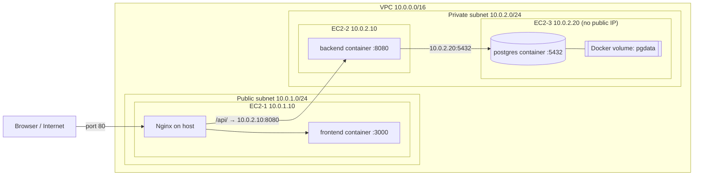

# ShopLite: Containerized 3-Tier Application on AWS EC2

A product catalogue for the fictional startup ShopLite, deployed as a 3-tier application on three separate EC2-style instances using Docker images from Docker Hub.

> **Note on the environment:** I did not have access to an AWS account, so the AWS infrastructure was **simulated locally with Incus virtual machines**. Each VM plays the role of an EC2 instance, Incus bridges play the role of VPC subnets, and Incus Network ACLs play the role of Security Groups. Everything inside the VMs (Docker, networks, volumes, Nginx, Docker Hub pulls) is identical to what would run on real EC2.

---

## 1. Project Overview

| Tier | Technology | Where it runs |
|---|---|---|
| Frontend | Static HTML/JS page served by Nginx (container) | EC2-1 (public subnet) |
| Reverse proxy | Nginx installed on the host (not a container) | EC2-1 |
| Backend | REST API in Go (`/api/products`, GET and POST) | EC2-2 (private subnet) |
| Database | PostgreSQL 16 with a named Docker volume | EC2-3 (private subnet, no public IP) |

**Security rule:** the database is never reachable from the internet. It has no public IP, sits in a private subnet, and accepts connections only from EC2-2 on port 5432.

### Architecture Diagram



### Security Groups (least privilege)

| Security Group | Attached to | Inbound rule | Source |
|---|---|---|---|
| `sg-ec2-1` | EC2-1 | TCP 80 | Anywhere (the only public entry point) |
| `sg-ec2-2` | EC2-2 | TCP 8080 | EC2-1 only (`10.0.1.10/32`) |
| `sg-ec2-3` | EC2-3 | TCP 5432 | EC2-2 only (`10.0.2.10/32`) |

No other inbound ports are open. Instances are managed through `incus exec`, which plays the role of AWS Systems Manager Session Manager, so no SSH port is exposed.

---

## 2. Docker Hub Images

| Image | Tag | Link |
|---|---|---|
| Backend | `v1.0.0` | https://hub.docker.com/r/tamim123/shoplite-backend |
| Frontend | `v1.0.0` | https://hub.docker.com/r/tamim123/shoplite-frontend |
| Database (official image) | `16-alpine` | https://hub.docker.com/_/postgres |

Pull commands:

```bash
docker pull YOURUSER/shoplite-backend:v1.0.0
docker pull YOURUSER/shoplite-frontend:v1.0.0
```

---

## 3. Repository Structure

```
shoplite/
├── backend/
│   ├── main.go
│   ├── go.mod
│   ├── go.sum
│   └── Dockerfile
├── frontend/
│   ├── index.html
│   └── Dockerfile
├── nginx/
│   └── shoplite.conf
├── screenshots/
└── README.md
```

---

## 4. Step-by-Step Deployment Process

### 4.1 Build the local "VPC"

```bash
incus network create vpc-public  ipv4.address=10.0.1.1/24 ipv4.nat=false ipv6.address=none
incus network create vpc-private ipv4.address=10.0.2.1/24 ipv4.nat=false ipv6.address=none

# outbound-only internet (acts as the NAT gateway)
sudo sysctl -w net.ipv4.ip_forward=1
sudo nft add table ip vpcnat
sudo nft 'add chain ip vpcnat post { type nat hook postrouting priority 100; }'
sudo nft add rule ip vpcnat post ip saddr 10.0.0.0/16 oifname "<host-interface>" masquerade
```

### 4.2 Create the Security Groups

```bash
incus network acl create sg-ec2-1
incus network acl rule add sg-ec2-1 ingress action=allow protocol=tcp destination_port=80

incus network acl create sg-ec2-2
incus network acl rule add sg-ec2-2 ingress action=allow protocol=tcp source=10.0.1.10/32 destination_port=8080

incus network acl create sg-ec2-3
incus network acl rule add sg-ec2-3 ingress action=allow protocol=tcp source=10.0.2.10/32 destination_port=5432
```

### 4.3 Launch the three instances

```bash
mk() { # name network ip acl
  incus init images:ubuntu/24.04 $1 --vm --network $2
  incus config device set $1 eth0 ipv4.address=$3
  incus config device set $1 eth0 security.acls=$4
  incus config device set $1 eth0 security.acls.default.ingress.action=drop
  incus start $1
}
mk ec2-1 vpc-public  10.0.1.10 sg-ec2-1
mk ec2-2 vpc-private 10.0.2.10 sg-ec2-2
mk ec2-3 vpc-private 10.0.2.20 sg-ec2-3

# "public IP" for EC2-1 only
incus config device add ec2-1 web proxy listen=tcp:0.0.0.0:8080 connect=tcp:10.0.1.10:80
```

Docker was installed on each instance with `curl -fsSL https://get.docker.com | sh`.

### 4.4 Build and push the images (on my own machine, not on the instances)

```bash
docker login
docker build -t YOURUSER/shoplite-backend:v1.0.0  ./backend
docker build -t YOURUSER/shoplite-frontend:v1.0.0 ./frontend
docker push YOURUSER/shoplite-backend:v1.0.0
docker push YOURUSER/shoplite-frontend:v1.0.0
```

### 4.5 Deploy the database on EC2-3

```bash
docker network create shoplite-net
docker volume create pgdata
docker run -d --name db --restart unless-stopped --network shoplite-net \
  -v pgdata:/var/lib/postgresql/data \
  -e POSTGRES_USER=shop -e POSTGRES_PASSWORD=<password> -e POSTGRES_DB=shoplite \
  -p 10.0.2.20:5432:5432 postgres:16-alpine
```

### 4.6 Deploy the backend on EC2-2

```bash
docker network create shoplite-net
docker run -d --name backend --restart unless-stopped --network shoplite-net \
  -e DATABASE_URL='postgres://shop:<password>@10.0.2.20:5432/shoplite?sslmode=disable' \
  -p 8080:8080 YOURUSER/shoplite-backend:v1.0.0
```

### 4.7 Deploy the frontend and Nginx on EC2-1

```bash
docker network create shoplite-net
docker run -d --name frontend --restart unless-stopped --network shoplite-net \
  -p 127.0.0.1:3000:80 YOURUSER/shoplite-frontend:v1.0.0

apt-get update && apt-get install -y nginx
# copy nginx/shoplite.conf to /etc/nginx/sites-available/shoplite
ln -sf /etc/nginx/sites-available/shoplite /etc/nginx/sites-enabled/shoplite
rm -f /etc/nginx/sites-enabled/default
nginx -t && systemctl reload nginx
```

`nginx/shoplite.conf`:

```nginx
server {
    listen 80 default_server;

    location /api/ {
        proxy_pass http://10.0.2.10:8080;
        proxy_set_header Host $host;
        proxy_set_header X-Real-IP $remote_addr;
    }

    location / {
        proxy_pass http://127.0.0.1:3000;
        proxy_set_header Host $host;
    }
}
```

### 4.8 Verify

1. Open `http://localhost:8080`, add a product, and refresh the page. The product is still listed.
2. Remove the DB container (`docker rm -f db`), start it again with the same `docker run` command, and refresh. The data is still there because it lives in the `pgdata` volume.
3. Reboot EC2-3 (`incus restart ec2-3`). The container comes back through `--restart unless-stopped`, and the data is intact.

---

## 5. Screenshots

### Running application


### `docker ps` on each EC2


### `docker network ls` and `docker network inspect` on each EC2


### `docker volume ls` and `docker volume inspect` on EC2-3


### Inbound rules of every Security Group


### EC2-3 details showing no public IP


### Product still present after the database container is removed and started again


---

## 6. Part E: Scenario-Based Questions

### Q1. The page loads, but the product list is empty and every API call shows "502 Bad Gateway". How do you find and fix the root cause?

The page itself loads, so the frontend container and Nginx on EC2-1 are working. A 502 means Nginx is up but cannot get a valid answer from the upstream, which is the backend on EC2-2. I would work from the outside in and follow the request path one hop at a time:

1. **Nginx on EC2-1.** Read `/var/log/nginx/error.log`. Messages like "connection refused" or "timed out" tell me whether the backend is down or unreachable.
2. **Network path from EC2-1 to EC2-2.** Run `curl -v http://10.0.2.10:8080/api/products` from EC2-1.
   - If it times out, the problem is the network or a security group. I would check that `sg-ec2-2` still allows port 8080 from EC2-1 and that EC2-2 is running.
   - If it is refused, nothing is listening on the port, so I move to the next step.
3. **Backend on EC2-2.** Run `docker ps -a` to see whether the container is running, restarting or exited, then `docker logs backend`. A common cause is that the backend cannot reach the database and has crashed.
4. **Database on EC2-3.** Run `docker ps` and `docker logs db` there. If the DB container is down, I start it again (the data is safe in the `pgdata` volume). I also check from EC2-2 that port 5432 on `10.0.2.20` is reachable and that `sg-ec2-3` still allows EC2-2.
5. **Fix and verify.** I repair the broken layer (restart the container, correct the security group rule or fix a wrong `DATABASE_URL`), then confirm with `curl` against the backend and reload the page in the browser.

After the demo I would find out why it broke (a bad deploy, a crashed container or a changed rule) and add monitoring and alerts so it does not happen silently again.

### Q2. The security team wants an OS security patch installed on the database server. How does the patch reach EC2-3 without breaking the security rule?

EC2-3 has no public IP and no inbound path from the internet, and it should stay that way. The patch does not need an inbound connection. The server pulls the update itself through **outbound-only** traffic. In AWS, the private subnet's route table sends internet-bound traffic to a **NAT gateway** placed in the public subnet. The NAT gateway allows connections that EC2-3 starts (such as `apt update && apt upgrade` reaching the Ubuntu mirrors) but does not allow anyone on the internet to start a connection to EC2-3.

I would connect to the server for maintenance through AWS Systems Manager Session Manager or a bastion host, not by opening a port to the world. The security group for EC2-3 stays exactly the same, with 5432 open only to EC2-2.

Safe procedure: take a snapshot of the volume or a database backup first, apply the patches in a planned maintenance window, and reboot if the kernel was updated. The DB container has `--restart unless-stopped` and its data lives in the `pgdata` volume, so it comes back with the data intact after the reboot.

In my local simulation, the nftables masquerade rule on the host acts as the NAT gateway, and EC2-3 was able to download Docker and OS updates through it while still having no way to be reached from outside.

### Q3. A new backend image broke adding products for every user. The CTO wants the old version back within 2 minutes. What do you do?

Because every image is pushed with an **immutable version tag** (`v1.0.0`, `v1.0.1`, and so on) instead of only `latest`, I always know exactly which version was working. The rollback takes about a minute on EC2-2:

```bash
docker rm -f backend
docker run -d --name backend --restart unless-stopped --network shoplite-net \
  -e DATABASE_URL='postgres://shop:<password>@10.0.2.20:5432/shoplite?sslmode=disable' \
  -p 8080:8080 YOURUSER/shoplite-backend:v1.0.0
```

Then I check `docker logs backend` and add a product in the browser to confirm it works. The old image is either still cached on the host or pulled from Docker Hub in seconds, and the database is unaffected. Only after the service is restored would I investigate the faulty `v1.0.1` image, fix it and release it as a new tag. If I had used only `latest`, I would not be able to say which image to go back to, which is why that tag alone is not allowed.

### Q4. A teammate opens the database port to 0.0.0.0/0 "just for testing" and forgets. What is the impact and how should the design prevent it?

**Impact:** if the rule really exposes the database, anyone on the internet could try to connect to PostgreSQL. Automated scanners find open database ports within minutes. They would attempt password guessing and exploits for known vulnerabilities. If they succeed, they could read, change or delete all product data, and the database server could be compromised.

**How the design prevents or limits it:**

- **No public IP and a private subnet.** EC2-3 has no public address and its subnet has no route to an internet gateway, so even a wrong `0.0.0.0/0` rule cannot make the server reachable from the internet. The rule would be wrong, but the traffic still has no path in. This is the main reason the security team's rule is met by design and not only by a single setting.
- **Least privilege rules.** The database security group allows 5432 only from EC2-2 (or from the backend's security group ID), never from a wide range.
- **Restricted permissions.** Only a few people should have IAM permission to change security groups, and changes should go through review.
- **Detection.** Alerts such as an AWS Config rule or Security Hub finding for "security group open to 0.0.0.0/0" would notify us quickly.
- **Defence in depth.** The database is bound to the private IP only, uses a strong password and has a host firewall.

In my simulation, the same idea applies: the database sits on an isolated private bridge, has no proxy or port forward device, and publishes its port only on `10.0.2.20`.

### Q5. After the demo, traffic grows 10 times. Which tier fails first, why, and what would you change?

The **database tier** would fail first. Nginx serving a small static page and the Go backend both scale easily and are cheap per request, but all backend requests end up at one PostgreSQL container on one small instance. That single node has limited CPU, memory, disk I/O and a limited number of connections (PostgreSQL's default `max_connections` is 100). With 10 times the traffic, connection limits and slow queries would appear first. It is also a single point of failure and cannot simply be duplicated, because a database holds state. The single backend instance would be the next to saturate.

**Changes to the architecture:**

- **Database:** move to a managed database such as Amazon RDS for PostgreSQL with **Multi-AZ** for failover and **read replicas** for read-heavy traffic, with automated backups. Use connection pooling (for example PgBouncer or RDS Proxy) and set sensible pool limits in the backend.
- **Backend:** run several backend instances in an **Auto Scaling Group** behind an **Application Load Balancer**, spread across Availability Zones.
- **Caching:** cache frequent product reads in Redis (ElastiCache) so fewer requests reach the database.
- **Frontend:** serve the static page from S3 with CloudFront (a CDN) so EC2-1 is no longer a bottleneck or a single point of failure.
- **Operations:** add monitoring and alarms (CloudWatch) and use health checks so unhealthy instances are replaced automatically.
